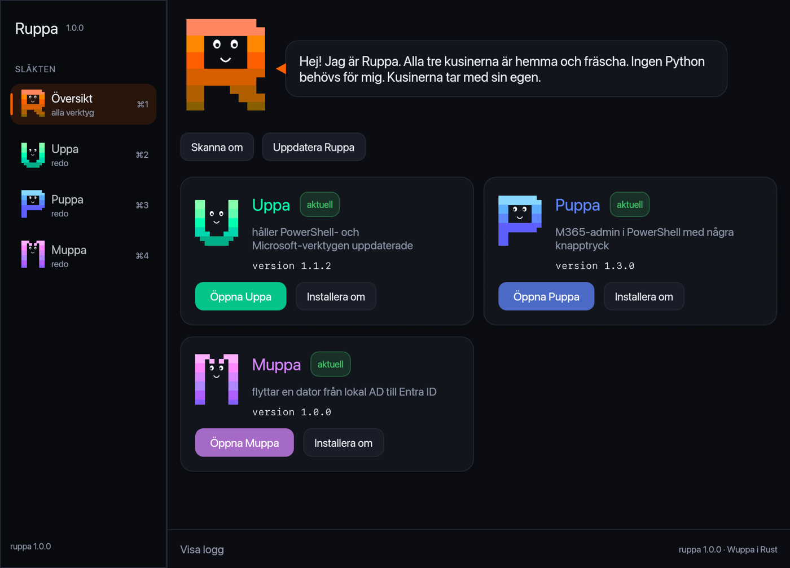
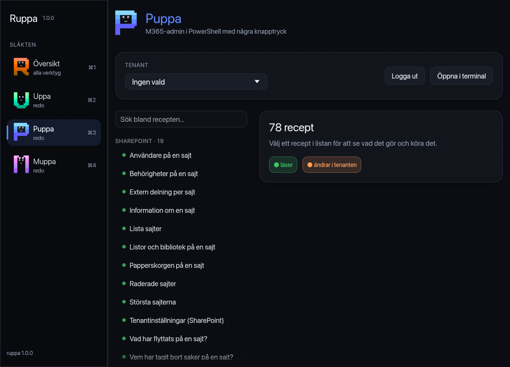
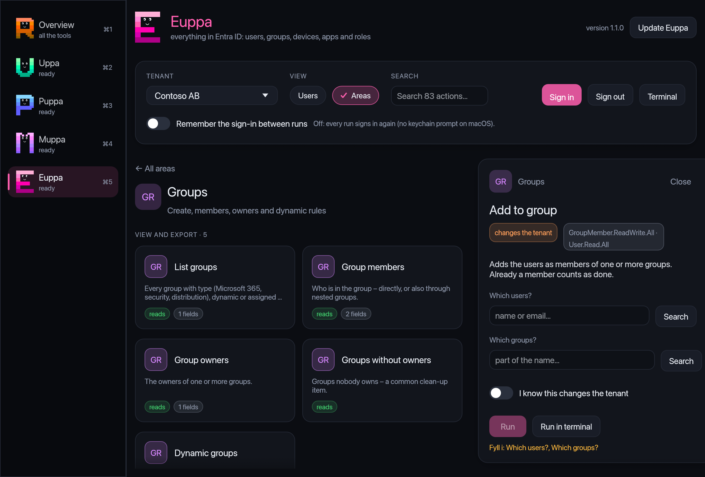

# Ruppa

<p align="center">
  
</p>

[Wuppa](https://github.com/pipebreak33/wuppa) i Rust, som en riktig app. Ruppa samlar kusinerna
[Uppa](https://github.com/pipebreak33/uppa), [Puppa](https://github.com/pipebreak33/puppa),
[Muppa](https://github.com/pipebreak33/muppa) och [Euppa](https://github.com/pipebreak33/euppa) i ett fönster, med
knappar, listor och formulär i stället för kommandon. Installera Ruppa så får du alla fyra. Allt hamnar i en mapp: `~/.ruppa`.

Ruppa är bara ett skal. Skripten, områdena, formulärets val och grundpaketen läses direkt ur kusinerna, så när du
uppdaterar Puppa (knappen *Uppdatera Puppa* överst på sidan) dyker nya skript och områden upp i Ruppa direkt, utan
någon ny Ruppa-version.

<p align="center">
  
</p>

## Installera (eller uppdatera – kör samma rad igen)

**Windows** (PowerShell):

```powershell
irm https://raw.githubusercontent.com/pipebreak33/ruppa/main/install.ps1 | iex
```

**macOS / Linux:**

```bash
curl -fsSL https://raw.githubusercontent.com/pipebreak33/ruppa/main/install.sh | sh
```

Installern hämtar rätt binär för datorn från den senaste releasen, kontrollerar SHA-256, och installerar sedan
kusinerna. Sist visar den hur lång tid det tog (oftast några sekunder). Ruppa dyker upp bland dina program med R-ikonen: `~/Applications/Ruppa.app` på macOS, Startmenyn på
Windows och programmenyn på Linux. Inga adminrättigheter behövs.

```
~/.ruppa/
  bin/      ruppa + startare för uppa, puppa, muppa och euppa (ligger i PATH)
  uppa/     Uppa
  puppa/    Puppa (med skripten)
  muppa/    Muppa
  euppa/    Euppa
  share/    ikonen
```

Kusinerna är Python-program. Saknas Python 3.8+ installerar Ruppa det per användare med winget på Windows. På macOS
räcker `xcode-select --install`.

## Avinstallera

**Windows:**

```powershell
irm https://raw.githubusercontent.com/pipebreak33/ruppa/main/uninstall.ps1 | iex
```

**macOS / Linux:**

```bash
curl -fsSL https://raw.githubusercontent.com/pipebreak33/ruppa/main/uninstall.sh | sh
```

Eller `ruppa uninstall` (`-y` för att slippa frågan), eller *Avinstallera Ruppa…* i översikten. Det tar bort `~/.ruppa`, Ruppa.app / genvägen i Startmenyn /
programmenyposten och PATH-raden (en kopia av skalfilen sparas som `.ruppa.bak`). Dina data behålls: Puppas tenants
(`~/.puppa`), Muppas mallar (`~/.muppa`), Euppas tenants (`~/.euppa`), Uppas cache (`~/.uppa`) och skript du skapat i `~/Documents`.

En enskild kusin tar du bort med *Avinstallera* på dess kort i översikten, eller `ruppa uninstall puppa euppa`.
Det tar bort kusinen ur `~/.ruppa`, men dess data finns kvar om du installerar den igen.

## Det här kan du göra

Växla mellan sidorna i menyn till vänster, eller med **⌘1–⌘5** (Ctrl+1–5 på Windows och Linux).

| Sida | |
|---|---|
| **Översikt** | Ruppa säger hej och berättar vad som saknas eller kan uppdateras. Installera, uppdatera eller öppna varje kusin med en knapp. |
| **Uppa** | Allt som kan uppdateras, grupperat per källa (Homebrew/winget, PowerShell-moduler, az, npm, .NET). Kryssa och klicka *Uppdatera valda*. Grundpaket (Bas, M365, Azure, Alla), *Logga ut från allt*, hälsokoll och städning. |
| **Puppa · Användare** | Växla till *Användare*: alla användare i tenanten med fuzzy-sök (namn, e-post, titel, avdelning). Kryssa en eller flera och välj vad du vill göra med dem: lägg till i grupp eller team, spärra, visa MFA, inloggningar, enheter … Skript som tar en användare körs en gång per person. Fält som grupp eller team har en *Sök*-knapp som söker i tenanten. |
| **Puppa** | Välj tenant och ett område (SharePoint, Exchange, Teams …), eller sök. Klicka på ett skript, fyll i fälten och klicka *Kör skript*. Resultatet visas som en tabell och sparas som CSV. Skript som ändrar något är orange och kräver att du bekräftar. Senast använda skript ligger överst. |
| **Euppa** | Allt i Entra ID. *Användare*: hämta alla i tenanten, kryssa en eller flera och välj åtgärd (grupp, licens, spärra, lösenord, MFA, TAP, roll …) – allt körs på en gång. *Områden*: användare, gäster, grupper, enheter (BitLocker, LAPS), appar (hemligheter som går ut, behörigheter, samtycke), roller och PIM, villkorlig åtkomst (report-only, undantag, platser), loggar, säkerhet och tenant. Fält som grupp, enhet, app, roll eller policy har en *Sök*-knapp. Resultatet visas som tabell och kan sparas som CSV. |
| **Muppa** | Migreringsguiden som ett formulär: användare, mappar (chips), BitLocker, domän, webbläsare, lokalt admin-konto. *Skapa skript och checklista*, och checklistan visas direkt. |

<p align="center">
  
  
</p>
<p align="center">
  
  
</p>
<p align="center">
  
</p>

Varje kusinsida har *Uppdatera Uppa/Puppa/Muppa/Euppa* överst. Behöver du terminalversionen av en kusin, till exempel för ett
skript som frågar något, finns *Öppna i terminal*. Då
körs kusinen i en inbyggd terminal i fönstret. Den fortsätter köra när du byter sida, och *Tillbaka till appen* tar
dig tillbaka.

## Teknik

- **Rust** med **egui/eframe**: en enda binär utan WebView eller andra beroenden hos användaren. egui valdes framför
  Tauri för att slippa WebView2/WebKitGTK, och framför iced för att det är enkelt att rita egna saker, som de levande
  maskoterna.
- Systemets typsnitt (SF Pro på macOS, Segoe UI på Windows, Inter/Cantarell/Ubuntu på Linux).
- Kusinerna hämtas som arkiv från GitHub och packas upp i `~/.ruppa/<kusin>`. Den gamla versionen byts ut först när
  den nya har klarat en syntaxkontroll. `~/.wuppa/config.json` delas med Wuppa (`repos`, `local`), och
  `UPPA_REPO`/`PUPPA_BRANCH` osv. fungerar som vanligt.
- Sidorna anropar kusinernas egna kommandon (`uppa update`, `puppa kör`, `muppa skapa`, `euppa kör … --json`) och läser deras data direkt
  (Uppas cache, Puppas skript och tenants). Konstanter som Muppas val, Puppas områden, Euppas åtgärder och Uppas grundpaket läses ur
  den installerade kusinen med Python (`core::describe`), så Ruppa behöver aldrig uppdateras för att följa med.
- Den inbyggda terminalen: `portable-pty` (ConPTY på Windows) + `vt100`.
- Self-update från GitHub Releases med SHA-256-kontroll.

Ruppa har också ett litet kommandoradsgränssnitt för skript: `ruppa status`, `ruppa install`, `ruppa update`,
`ruppa uppa|puppa|muppa|euppa …`, `ruppa self-update` och `ruppa uninstall`.

### Bygga själv

```bash
cargo build --release          # target/release/ruppa
cargo test && cargo clippy --all-targets -- -D warnings
python3 scripts/make_icon.py   # ritar om ikonen (assets/icon)
```

En tagg `v*` bygger macOS (universal), Linux (x86_64, arm64) och Windows (x86_64, arm64) och lägger dem i en release.

## Licens

MIT
