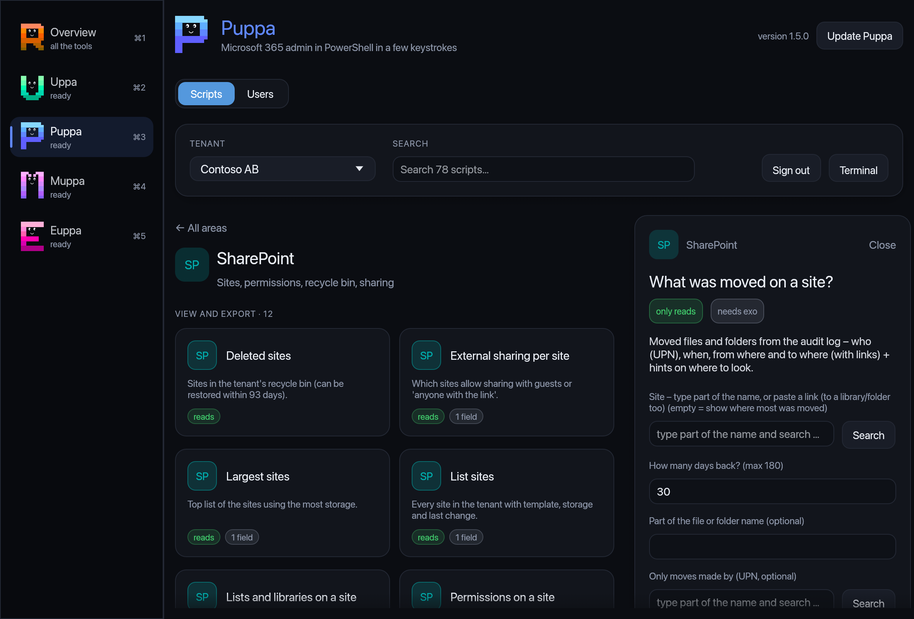
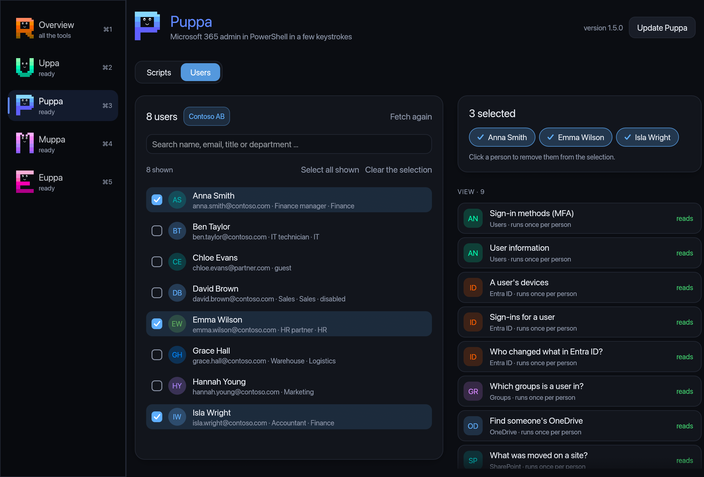

# Ruppa

**English** · [Svenska](README.sv.md)

<p align="center">
  
</p>

[Wuppa](https://github.com/pipebreak33/wuppa) in Rust, as a real app. Ruppa brings the tools
[Uppa](https://github.com/pipebreak33/uppa), [Puppa](https://github.com/pipebreak33/puppa),
[Muppa](https://github.com/pipebreak33/muppa) and [Euppa](https://github.com/pipebreak33/euppa) together in one window, with
buttons, lists and forms instead of commands. Install Ruppa and you get all four. Everything goes in one folder: `~/.ruppa`.

Ruppa is only a shell. The scripts, the areas, the form's choices and the bundles are read straight from the tools, so when you
update Puppa (the *Update Puppa* button at the top of the page), new scripts and areas show up in Ruppa directly, without
a new Ruppa version.

<p align="center">
  
</p>

## Install (or update: run the same line again)

**Windows** (PowerShell):

```powershell
irm https://raw.githubusercontent.com/pipebreak33/ruppa/main/install.ps1 | iex
```

**macOS / Linux:**

```bash
curl -fsSL https://raw.githubusercontent.com/pipebreak33/ruppa/main/install.sh | sh
```

The installer fetches the right binary for the computer from the latest release, checks the SHA-256, and then installs
the tools. Finally it shows how long it took (usually a few seconds). Ruppa shows up among your apps with the R icon: `~/Applications/Ruppa.app` on macOS, the Start menu on
Windows and the application menu on Linux. No admin rights are needed.

```
~/.ruppa/
  bin/      ruppa + launchers for uppa, puppa, muppa and euppa (in PATH)
  uppa/     Uppa
  puppa/    Puppa (with the scripts)
  muppa/    Muppa
  euppa/    Euppa
  share/    the icon
```

The tools are Python programs. If Python 3.8+ is missing, Ruppa installs it per user with winget on Windows. On macOS
`xcode-select --install` is enough.

## Uninstall

**Windows:**

```powershell
irm https://raw.githubusercontent.com/pipebreak33/ruppa/main/uninstall.ps1 | iex
```

**macOS / Linux:**

```bash
curl -fsSL https://raw.githubusercontent.com/pipebreak33/ruppa/main/uninstall.sh | sh
```

Or `ruppa uninstall` (`-y` to skip the question), or *Uninstall Ruppa…* in the overview. It removes `~/.ruppa`, Ruppa.app / the Start menu shortcut /
the application menu entry and the PATH line (a copy of the shell file is kept as `.ruppa.bak`). Your data is kept: Puppa's tenants
(`~/.puppa`), Muppa's templates (`~/.muppa`), Euppa's tenants (`~/.euppa`), Uppa's cache (`~/.uppa`) and scripts you created in `~/Documents`.

A single tool is removed with *Uninstall* on its card in the overview, or `ruppa uninstall puppa euppa`.
That removes the tool from `~/.ruppa`, but its data is still there if you install it again.

## Language

Ruppa speaks **English** by default and **Swedish** on request. The **Svenska / English** button at the top of the overview
switches the window at once, and every tool follows, since the choice is shared by the whole troupe (`~/.truppa/config.json`).
From the command line: `ruppa lang sv` or `ruppa lang en`.

## What you can do

Switch between the pages in the menu on the left, or with **⌘1–⌘5** (Ctrl+1–5 on Windows and Linux).

| Page | |
|---|---|
| **Overview** | Ruppa says hi and tells you what is missing or can be updated. Install, update or open each tool with one button. |
| **Uppa** | Everything that can be updated, grouped per source (Homebrew/winget, PowerShell modules, az, npm, .NET). Tick and click *Update selected*. Bundles (Base, M365, Azure, All), *Sign out of everything*, a health check and clean-up. |
| **Puppa · Users** | Switch to *Users*: every user in the tenant with fuzzy search (name, email, title, department). Tick one or more and choose what to do with them: add to a group or team, block, show MFA, sign-ins, devices … Scripts that take one user run once per person. Fields like group or team have a *Search* button that searches the tenant. |
| **Puppa** | Pick a tenant and an area (SharePoint, Exchange, Teams …), or search. Click a script, fill in the fields and click *Run script*. The result is shown as a table and saved as CSV. Scripts that change something are orange and need you to confirm. Recently used scripts are at the top. |
| **Euppa** | All of Entra ID. *Users*: fetch everyone in the tenant, tick one or more and choose an action (group, license, block, password, MFA, TAP, role …), and everything runs at once. *Areas*: users, guests, groups, devices (BitLocker, LAPS), apps (expiring secrets, permissions, consent), roles and PIM, Conditional Access (report-only, exclusions, locations), logs, security and the tenant. Fields like group, device, app, role or policy have a *Search* button. The result is shown as a table and can be saved as CSV. |
| **Muppa** | The migration wizard as a form: user, folders (chips), BitLocker, domain, browsers, local admin account. *Create script and checklist*, and the checklist is shown right away. |

<p align="center">
  
  
</p>
<p align="center">
  
  
</p>
<p align="center">
  
</p>

Every tool page has *Update Uppa/Puppa/Muppa/Euppa* at the top. If you need the terminal version of a tool, for example for a
script that asks something, there is *Open in terminal*. The tool then
runs in a built-in terminal in the window. It keeps running when you switch pages, and *Back to the app* takes
you back.

## Technology

- **Rust** with **egui/eframe**: a single binary with no WebView or other dependencies for the user. egui was chosen over
  Tauri to avoid WebView2/WebKitGTK, and over iced because it is easy to draw your own things, like the living
  mascots.
- The system font (SF Pro on macOS, Segoe UI on Windows, Inter/Cantarell/Ubuntu on Linux).
- The tools are fetched as archives from GitHub and unpacked into `~/.ruppa/<tool>`. The old version is replaced only once
  the new one has passed a syntax check. `~/.wuppa/config.json` is shared with Wuppa (`repos`, `local`), and
  `UPPA_REPO`/`PUPPA_BRANCH` and so on work as usual.
- The pages call the tools' own commands (`uppa update`, `puppa run`, `muppa create`, `euppa run … --json`) and read their data directly
  (Uppa's cache, Puppa's scripts and tenants). Constants like Muppa's choices, Puppa's areas, Euppa's actions and Uppa's bundles are read from
  the installed tool with Python (`core::describe`), so Ruppa never needs an update to keep up.
- The built-in terminal: `portable-pty` (ConPTY on Windows) + `vt100`.
- Self-update from GitHub Releases with a SHA-256 check.

Ruppa also has a small command line for scripts: `ruppa status`, `ruppa install`, `ruppa update`,
`ruppa uppa|puppa|muppa|euppa …`, `ruppa self-update`, `ruppa uninstall` and `ruppa lang`.

### Build it yourself

```bash
cargo build --release          # target/release/ruppa
cargo test && cargo clippy --all-targets -- -D warnings
python3 scripts/make_icon.py   # redraws the icon (assets/icon)
```

A `v*` tag builds macOS (universal), Linux (x86_64, arm64) and Windows (x86_64, arm64) and puts them in a release.

## License

MIT
